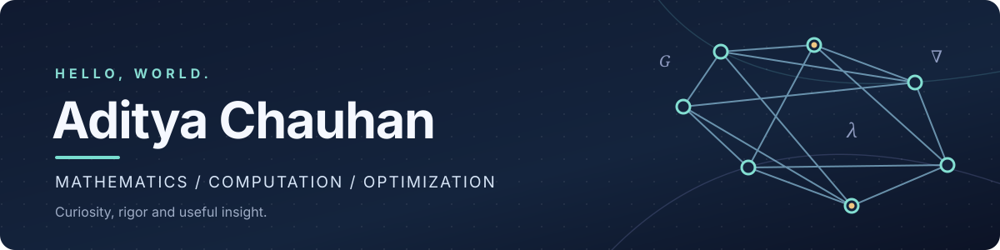

<!-- Personal GitHub profile • last refreshed October 2026 -->
<div align="center">



<br />

**M.Sc. Mathematics · IIT Bhubaneswar (2026)**

*Mathematical thinking, computational experiments, and practical problem-solving.*

[](https://aditya-math.me)
[](https://www.linkedin.com/in/aditya01ad/)
[](mailto:aditya1512me@gmail.com)
[](https://github.com/aditya01ad?tab=repositories)

</div>

---

### About me

I'm **Aditya Chauhan**, a mathematics postgraduate from **IIT Bhubaneswar**, interested in what happens when rigorous mathematical ideas meet computation and real-world decisions.

My academic work focuses on **spectral graph theory**, particularly **cospectral graphs and spectral determination**. Alongside that research background, I'm building practical experience in **operations research, mathematical optimization, Python-based analysis, and decision modeling**.

I enjoy moving between theory and implementation: understanding *why* a method works, writing an experiment to explore it, and asking what the result actually means. I'm especially interested in roles where mathematics can help make systems, processes, or decisions better.

- **Academic foundation:** graph theory, linear algebra, matrix methods, combinatorics, and mathematical reasoning
- **Applied direction:** operations research, optimization modeling, analytics, algorithms, and computational problem-solving
- **Currently developing:** stronger end-to-end Python workflows, LP/MIP modeling, data analysis, and reproducible technical projects
- **Open to:** entry-level operations research, optimization, quantitative/analytical, and mathematical computing opportunities; also interested in research collaborations

### Two sides of my work

| 🔬 Mathematics & research | 📈 Optimization & analytics |
| :--- | :--- |
| Spectral graph theory, eigenvalues and graph invariants | Linear and mixed-integer programming |
| Cospectrality, graph constructions, DS questions | Transportation, allocation and facility-location models |
| Graph algorithms, SageMath and computational experiments | Python, NumPy, pandas and PuLP practice |
| Proof-oriented investigation and interpretation | Modeling assumptions, solver results and sensitivity analysis |

These are complementary interests, not separate identities: mathematical structure helps me formulate problems, and computation helps me investigate them.

### Selected work

| Project | What you'll find | Focus |
| :--- | :--- | :--- |
| **[OR Analyst Prep · Colab notebooks](https://github.com/aditya01ad/colab_codes/tree/main/notebooks/OR_Prep)** | Worked Python, NumPy, LP and integer-programming notebooks, including transportation, knapsack, product-mix and facility-location exercises. An end-to-end project is **in progress**. | Optimization · Python · PuLP |
| **[Spectral Project](https://github.com/aditya01ad/spectral-project)** | Research-oriented code and notebooks exploring graph spectra, cospectrality, zero forcing, minimum rank and graph-generation methods. | Graph theory · Python · SageMath |
| **[DS Analyzer](https://github.com/aditya01ad/ds-analyzer)** | A Python CLI prototype for structural/spectral invariants and searching for cospectral mates with Godsil–McKay switching. **Experimental; testing and validation are ongoing.** | Algorithms · NetworkX · SciPy |
| **[Optimization Techniques](https://github.com/aditya01ad/Optimization-techniques)** | MATLAB coursework implementations covering numerical methods, ODEs and computational mathematics. | MATLAB · Numerical methods |
| **[Academic Portfolio](https://github.com/aditya01ad/aditya-academic-canvas)** | My portfolio website source, combining academic background, projects, research interests and contact details. | React · TypeScript |

> I value accurate descriptions of work in progress. A computational search that fails to find a counterexample is not automatically a mathematical proof, and an illustrative notebook is not the same as a production-ready system.

### Research & education

**M.Sc. Mathematics — Indian Institute of Technology Bhubaneswar**  
2024–2026 · CGPA **8.38/10**

**Thesis:** *Spectral Determination of Graphs with Pendant Attachments*  
**Supervisor:** Prof. Sasmita Barik

My thesis explored spectral properties of graph families with pendant attachments and questions of when adjacency spectra can distinguish graph structures. I used computational graph-theoretic tools alongside mathematical investigation.

**B.Sc. Mathematics — Veer Narmad South Gujarat University (VNSGU)**  
2021–2024 · CGPA **8.63/10**

### Tools & interests

**Tools I've used in projects and coursework**


**Mathematical and computational libraries:** NetworkX · SymPy · SageMath · PuLP · Matplotlib

**Also explored:** Java · React · TypeScript

**Subjects I want to keep exploring:** mathematical optimization, network science, combinatorial algorithms, numerical computing, graph spectra, and their applications in industry and research.

### What I'm building toward

```text
Mathematical foundation
         |
   Computational modeling
         |
 Data + optimization tools
         |
 Validated results and clear insight
```

My near-term focus is to turn mathematical knowledge into **well-scoped, independently reproducible applied projects**: clean datasets, explicit assumptions, correct formulations, tested code, interpretable results, and honest limitations.

### Beyond the technical work

I'm curious about mathematics, science, technology and ideas outside my immediate field. I like learning how different disciplines approach the same problem, and I welcome thoughtful conversations and collaborations.

<div align="center">

**Let's connect and exchange ideas.**

[Portfolio](https://aditya-math.me) · [LinkedIn](https://www.linkedin.com/in/aditya01ad/) · [Email](mailto:aditya1512me@gmail.com) · [Repositories](https://github.com/aditya01ad?tab=repositories)

<sub>Based in India · Open to relevant opportunities and collaboration</sub>

</div>
